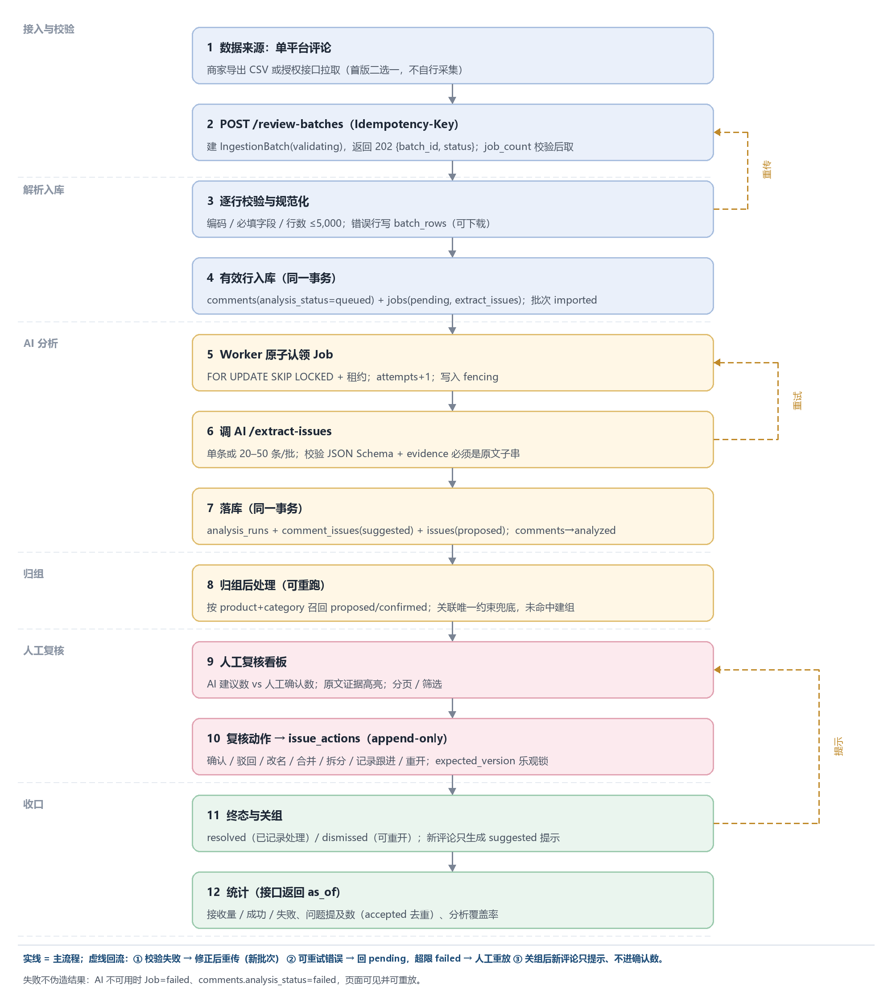

# 商品评论管理与重复问题发现系统（单平台初版）

把选定电商平台的商品评论批量导入，用 AI 逐条提取具体问题并附原文证据，把**同一商品内
语义相近的问题**归成候选问题组，交由运营人工确认、修改、合并/拆分/驳回并记录跟进。

系统只提供线索与整理，**不判定产品缺陷/责任/根因，也不向原平台执行任何操作**。
详细目标架构见 [docs/architecture.md](docs/architecture.md)。

- 当前阶段：**W5 串行关口完成**（契约冻结、迁移可执行、R1 接入链路、静态 UI、规则基线 Worker/AI）
- 分工与边界：[docs/team-division.md](docs/team-division.md)
- 进度与下一步：[docs/progress.md](docs/progress.md)

## 核心闭环

```
CSV/接口 → 批次接收与校验 → comments + jobs → Worker 调 AI 提取问题
        → comment_issues(suggested) + issues(proposed) → 人工复核（accept/reject/…）
        → issue_actions 审计 → resolved/dismissed → 统计（接收/成功/失败/问题提及数）
```



## 功能（当前实现状态）

| 模块 | 状态 |
| --- | --- |
| 批次接入：CSV 解析、逐行校验、错误清单、去重 upsert、评论版本、建 Job | ✅ R1 |
| 幂等批次（`Idempotency-Key`）、批次进度派生、评论/问题组/任务/统计读接口 | ✅ R1 |
| 静态界面：批次 / 评论 / 问题组 / 复核 / 关于（五页导航，mock 数据） | ✅ R4 starter |
| Worker：原子认领 + 租约 + AI 调用 + 落库 + 失败标记（最小闭环） | 🟡 R2 加固中 |
| AI 服务：`/extract-issues` 关键词规则基线 + 证据定位；`/suggest-groups` 占位 | 🟡 R3 替换为 LLM |
| 复核动作 API（确认/驳回/改名/合并/拆分/记录跟进/重开） | ⏳ R4 |
| 真实平台入口验证、multipart 上传、标注集与评测 | ⏳ W6–W10 |

## 技术栈

- Python 3.11、FastAPI、SQLAlchemy 2、Alembic、PostgreSQL 16
- Worker 轮询数据库任务队列；内部 AI 服务走 HTTP，可替换为 LLM
- Prometheus 指标（可选 profile）、JSON 结构化日志
- 前端：原生 HTML/CSS/JS（无构建步骤），由 API 挂载在 `/ui/`

## 目录结构

```
services/
  common/       # 模型、契约、配置、数据库（共享层，R1 主写）
  api/app/      # FastAPI：ingestion.py（R1 接入）、main.py（接口）
  worker/app/   # 后台任务 Worker（R2）
  ai/app/       # 内部 AI 服务（R3）
frontend/       # 静态界面（R4，挂载 /ui/）
alembic/        # 迁移：0001 旧骨架 → 0002 评论域 → 0003 收敛
docs/           # architecture / operations / team-division / progress / Proposal / 图
review/         # 评审报告、独立评审、实现复核、验证脚本（团队过程文件）
scripts/        # seed / reset_database
tests/          # unit + integration（内存 SQLite）+ smoke
```

## 快速开始

```bash
cp .env.example .env
docker compose up --build
```

启动后：

- API 文档：<http://localhost:8000/docs>
- 静态界面：<http://localhost:8000/ui/>
- AI 服务文档：<http://localhost:8100/docs>
- Prometheus（可选）：`docker compose --profile observability up`

首次或需要演示数据时：

```bash
make seed        # 箱包评论样例 + 问题组
```

清库重建（会删除全部数据）：

```bash
make reset-db
```

## 常用命令

```bash
make up          # 启动全部服务
make down        # 停止
make test        # 单元 + 集成测试（不需要数据库）
make migrate     # alembic upgrade head
make seed        # 演示数据
make reset-db    # 清库 + 重建 schema
make lint        # ruff check
```

完整运维说明（端口、失败处理、常见问题）见 [docs/operations.md](docs/operations.md)。

## 主要接口

| 接口 | 说明 |
| --- | --- |
| `POST /review-batches` | 接收批次（JSON 内嵌 `csv_text` 或 `comments`，支持 `Idempotency-Key`） |
| `GET /review-batches/{id}` | 批次进度（导入计数 + 分析进度 + `as_of`） |
| `GET /review-batches/{id}/errors` | 逐行校验错误 |
| `GET /comments`、`GET /comments/{id}` | 评论列表 / 详情（含版本、证据、最近一次分析） |
| `GET /issues`、`GET /issues/{id}` | 问题组列表 / 详情（AI 建议数、人工确认数、审计） |
| `GET /jobs/{id}` | 分析任务状态与错误码 |
| `GET /stats/summary` | 统计口径汇总 |
| `/health/live`、`/health/ready`、`/metrics` | 健康检查与指标 |

契约以 `services/common/schemas.py` 与 `docs/architecture.md` §8 为准。

## 测试

```bash
make test
# 或
pytest -q tests/unit tests/integration
```

测试使用内存 SQLite（`StaticPool`），不依赖数据库；迁移用 PostgreSQL，CI 会跑
`upgrade → downgrade → upgrade` 往返。冒烟测试需要运行中的服务：

```bash
SMOKE_BASE_URL=http://localhost:8000 pytest tests/smoke -q
```

## 团队与文档

| 成员 | 角色 |
| --- | --- |
| FEI, Wenxiang | R1 数据与接入（技术负责人） |
| XIANG, Ke | R2 流水线与可靠性 |
| XU, Chao | R3 AI 与评测 |
| ZHANG, Mingyang | R4 复核与产品端 |

- [系统架构](docs/architecture.md) ｜ [分工与边界](docs/team-division.md) ｜ [进度](docs/progress.md) ｜ [运维](docs/operations.md)
- [Week 4 提交说明](templates/submissions/week04/README.md) ｜ [评审报告与分工](review/系统设计评审与四人分工.md)
- 团队过程文件（评审/复核/验证脚本）：[review/](review/)
