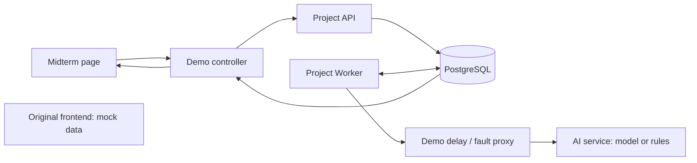
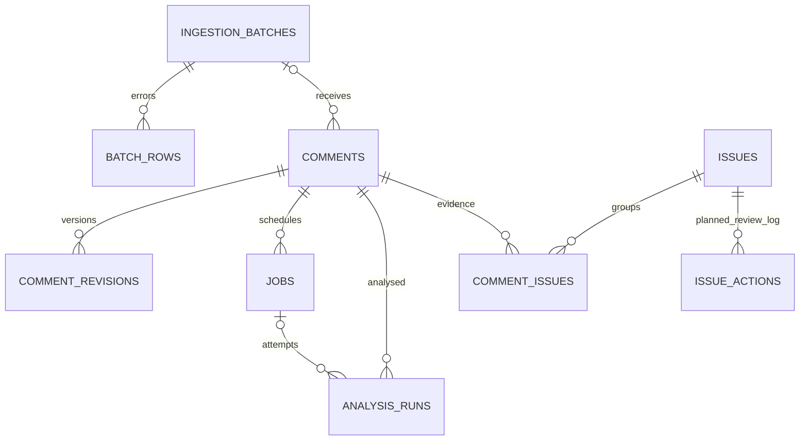
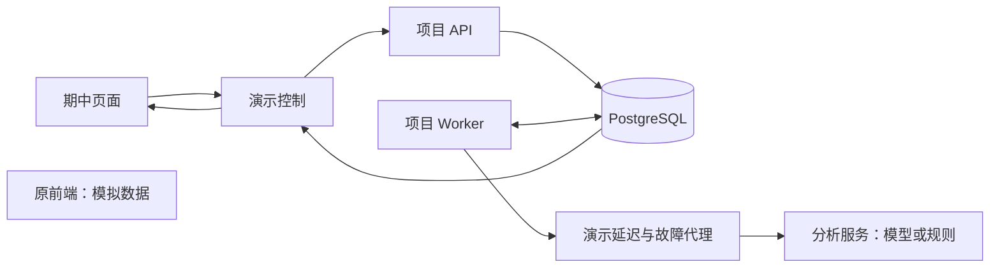
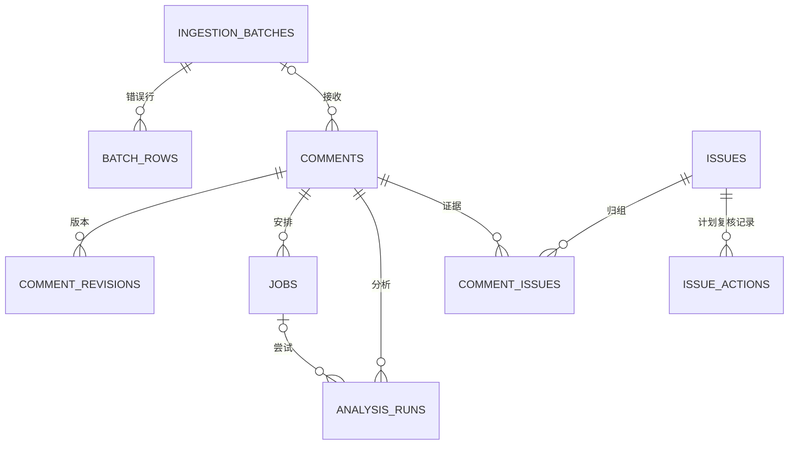
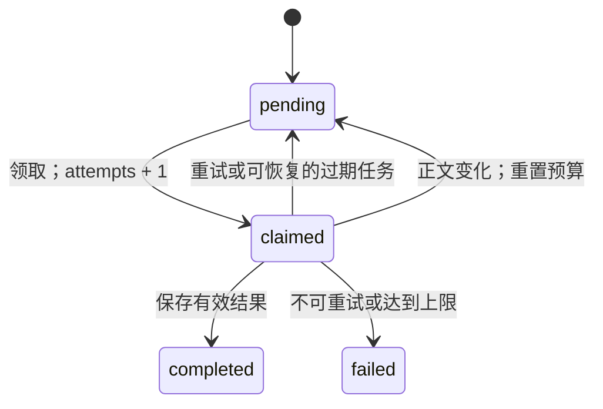

# Architecture / 系统架构

## English

### 1. Purpose and scope

The target product helps staff review recurring issues in product comments. We keep source text
and evidence separate from suggestions. Only staff should confirm an issue or record a resolution.
The current milestone covers ingestion, background analysis, persistence and a small demo page.
Semantic grouping and the complete human-review workflow remain planned work.

### 2. Components and current data flow

The demo controller starts the existing API, AI and Worker as child processes. It converts the
submitted review into CSV input for the existing ingestion API and reads the saved state for display.
The proxy adds a three-second delay and optional HTTP 503 responses. It does not replace analysis
or result-saving logic. The standalone Compose runs the controller and its own PostgreSQL service.

In the full project, `compose.yaml` runs API, Worker, AI and PostgreSQL separately, with optional
Prometheus. The original frontend is served by the API at `/ui/` but still uses mock data.

| Component | Responsibility | Code |
| --- | --- | --- |
| Ingestion/API | Validate CSV text or JSON reviews, save imports and jobs, expose queries | `services/api/app/` |
| Worker | Claim jobs, call analysis, validate results, persist or retry | `services/worker/app/` |
| Analysis | Extract issues with a model or Chinese/English rules and source evidence | `services/ai/app/` |
| Shared data | Models and request/response definitions | `services/common/` |
| Midterm interface | Demo controls, state display and fault scenarios | `demo/midterm/` |
| Product frontend | Five-page layout and mock review interactions | `frontend/` |

### 3. One review through the system

1. `POST /review-batches` parses and validates input, then commits valid comments, jobs and row errors.
   It returns HTTP 202 after ingestion; background analysis runs separately.
2. A new comment is `queued`; its job is `pending`. Each comment has at most one active job.
3. Worker claims a due job under a database lock, changes the comment to `analyzing`, records an
   expiry time, and increments `attempts`. It releases the transaction before the HTTP request.
4. `run_extraction()` selects the model or rules, with rule fallback for expected model failures.
   AI returns `yes`, `no` or `unknown`, categories, evidence and result provenance. Worker validates the output and
   locates evidence in the submitted text. Unlocated evidence is discarded; the verdict becomes `unknown`.
5. Before writing, Worker checks its original claim and the current review text. A superseded claim
   cannot write results. Changed input is queued again with a fresh attempt budget.
6. Analysis records, issue links, comment outcome and job completion are committed together.
   The demo reads these stored results. `no` and `unknown` are successful analyses, not job failures.

In the rule path, English matching ignores letter case and checks common negations. Evidence is a verbatim, bounded
sentence window from the submitted text. English praise/no-problem cues can produce `no`;
other unmatched English usually returns `unknown`. Existing Chinese keyword decisions are retained. The rule
version is `rule-baseline-2`; these changes do not add general semantic understanding.

Current grouping reuses the earliest active candidate/confirmed group within the same platform,
shop, product and category. Group creation is protected against concurrent duplicates.
It does not compare descriptions semantically or call `/suggest-groups`.

Rule coverage is limited to selected phrases in four categories. After-sales and warranty complaints
have no dedicated rules. Chinese and English coverage is not equivalent for every expression.
Unmatched Chinese text normally falls back to `no`; unmatched English normally becomes `unknown`,
but positive cues can also produce `no` when an unsupported complaint is present. Consequently,
`no` is not a reliable negative finding. Evidence validation checks only that a quotation occurs
in the source, not whether the category or interpretation is correct. Accuracy on a labelled,
representative dataset has not been established.

### 4. Stored data

There are nine domain tables. `issue_actions` supports the planned review workflow; the table and
request models do not mean that review-action APIs are implemented. Full fields and constraints
are in `services/common/models.py`; migrations end at `20261027_0003`.

Review identity is `(platform, shop_id, product_id, source_review_id)`. Missing source IDs are
assigned a stable `synth:` ID using SHA-256 inputs. Body changes create revision records.
Current unreviewed AI suggestions can be superseded; accepted/rejected or human-created links
are preserved. Superseded suggestions are excluded from current suggestion counts.
Import counters are stored on batches; analysis progress and displayed completion status are
derived when queried. These are different measures and should not be added together.

### 5. Failure handling

```mermaid
stateDiagram-v2
    [*] --> pending
    pending --> claimed: claim; attempts + 1
    claimed --> completed: valid result saved
    claimed --> pending: retry or recoverable expiry
    claimed --> failed: non-retryable error or limit reached
    claimed --> pending: input changed; reset budget
```

`attempts` counts actual claims, including the first attempt. Recovery does not increment it.
Default jobs allow three attempts; transport failures wait 60 then 300 seconds before retries.
Invalid output gets at most one retry. Other HTTP 4xx errors and unexpected programming errors
do not automatically retry. Every poll checks for expired jobs; an exhausted job becomes failed.
The recovery script uses the same rules. There is no manual retry/recover API or batch replay tool yet.
If database access also prevents recording a failure, the claim is left for expiry recovery;
an analysis record cannot be guaranteed in that situation.

Demo-only overrides shorten waits to 3 and 6 seconds and the lease to 60 seconds.
They do not change the full-project defaults.

### 6. Interfaces and next work

Current API routes cover batch upload/progress/errors, comments, issues, job status, summary stats,
health and metrics. Batch upload accepts JSON fields `csv_text` or `comments`; repeated batch requests
can use the JSON `idempotency_key` field. Direct multipart upload is not implemented.
AI exposes `/extract-issues`; `/suggest-groups` remains a baseline placeholder.

Planned work: real review samples, model-quality evaluation and semantic grouping; live data in the
product frontend; persistent human decisions, group merge/split/follow-up actions; manual job replay.
The original [target workflow image](assets/fig1_end_to_end_flow.png) remains a design reference,
not a diagram of completed features. R2 details are in [r2-implementation.md](r2-implementation.md).

### 7. AI Integration Card

| Item | Our project's answer |
| --- | --- |
| Workflow step that calls the model (job type) | The `extract_issues` job analyses one stored product review. The Worker reads a fixed review snapshot and calls `POST /extract-issues`. The AI service uses `run_extraction()` to select rules or call `llm.call_llm_extraction()`. The Worker validates the returned result and evidence before saving it. |
| Exact input fields sent (minimised) | The model receives the review `body` as the user message. The system message contains the task, allowed categories and output requirements. `comment_id` and `product_id` travel between the Worker and internal AI service, but are omitted from the external model messages. Review text is limited to 2,000 characters. |
| Output schema — enum values, ranges and max lengths | `has_issue` is `yes`, `no` or `unknown`. Each issue contains `category_id`, `description` and `evidence_text`. Allowed categories are `quality`, `logistics`, `mismatch`, `usability` and `other`. Category IDs are 1–40 characters; descriptions and evidence are 1–500 characters. The model adapter permits at most one issue per category. `yes` requires issues; the model adapter requires an empty list for `no` and `unknown`. Model and prompt version fields are limited to 64 characters. |
| Accept rule — threshold and source conditions | Results must pass JSON parsing, schema and category checks. The Worker also checks the comment ID, output versions and verbatim evidence against the submitted snapshot. Unmatched evidence is discarded and the verdict becomes `unknown`. Valid candidates from either `llm` or `heuristic` are saved as `suggested`. The current implementation has no confidence score or automatic-acceptance threshold. |
| Review state name — who reviews | Candidate links use `suggested`; human decisions use `accepted` or `rejected`. Intended reviewers are staff checking the original review and evidence. The data model and Worker protection for existing human decisions are present. Review-write endpoints and a dedicated queue for `unknown` comments remain to be implemented. |
| Fallback method — how it is marked | Expected model-call failures, including missing configuration, timeout, network errors, HTTP errors and invalid output, invoke the existing Chinese/English rules. The result carries `source=heuristic` and a `fallback_reason`, such as `timeout`, `rate_limited` or `schema_violation`. Successful model output carries `source=llm`. The comment-detail API and bilingual demo expose this information. |
| Provenance columns | `AnalysisRun` stores `model_version`, `prompt_version`, `category_version`, `input_hash`, `latency_ms`, status and timestamps. `source` and `fallback_reason` are stored inside `AnalysisRun.output_json`. `CommentIssue` links evidence to its analysis run and comment version, with evidence text, offsets and verification status. |
| Provider, base URL, model and local alternative | The current local configuration uses `openai_compatible`, base URL `https://hkust.azure-api.net/hkust-genai/v1`, and model `gemini-2.5-flash-lite`. Authentication uses the `api-key` header. The model timeout is configured as 8 seconds. The local alternative is the existing Chinese/English rule engine, selected with `LLM_PROVIDER=heuristic`. |
| Rate limit designed for — behaviour on 429 | The current single Worker processes jobs sequentially. A provider-specific requests-per-minute target and application rate limiter have not been established. HTTP 429 becomes `rate_limited` and triggers immediate rule fallback. When fallback returns a valid result, the Worker completes that job. |
| Privacy note — what is never sent | The external model messages contain review text, category definitions and task instructions. The application does not add database credentials, internal job IDs, shop IDs or the full database record to those messages. The API key is sent in the provider authentication header. Review text may itself contain personal information; automatic redaction is not implemented. |
| Tests proving fallback and review without a key | Existing rule, Worker and integration tests provide regression coverage for the earlier processing path. This commit adds no dedicated automated tests for the LLM adapter, its fallback paths or human-review writes. Key-free mocked tests for these new behaviours remain to be added. |
| Golden set — size, location and who labels | A versioned, manually labelled review-evaluation set has not yet been added. Its size, repository location and labelling assignments are not established. Existing Chinese/English examples support functional checks; extraction accuracy has not yet been measured on a labelled dataset. |

## 中文

### 1. 用途与范围

完整产品用于帮助工作人员检查商品评论中的重复问题。原文及证据与分析建议分开保存，
问题确认和处理完成应由人工决定。当前里程碑覆盖导入、后台分析、结果保存和小型演示页面。
语义归组和完整人工复核流程仍是后续工作。

### 2. 组件与当前数据流

演示控制程序以子进程启动现有 API、AI 和 Worker，将页面评论整理成 CSV 输入交给现有导入接口，
并读取已保存状态展示。代理增加三秒等待和可选的 HTTP 503，不替代分析与结果保存逻辑。
独立 Compose 运行演示控制程序及其 PostgreSQL 服务。

原项目的 `compose.yaml` 分别运行 API、Worker、AI 和 PostgreSQL，可选启用 Prometheus。
原前端通过 API 的 `/ui/` 提供，但业务数据仍来自模拟数据。

| 组件 | 职责 | 代码 |
| --- | --- | --- |
| 导入／API | 校验 CSV 文本或 JSON 评论，保存导入和任务，提供查询 | `services/api/app/` |
| Worker | 领取任务、调用分析、检查结果、保存或重试 | `services/worker/app/` |
| 分析 | 调用模型或中英文规则提取问题和原文证据 | `services/ai/app/` |
| 共享数据 | 数据模型及输入输出格式 | `services/common/` |
| 期中界面 | 演示控制、状态展示和故障场景 | `demo/midterm/` |
| 产品前端 | 五页布局及模拟复核交互 | `frontend/` |

### 3. 一条评论的处理过程

1. `POST /review-batches` 解析并检查输入，提交有效评论、任务和错误行记录，之后返回 HTTP 202。
   导入完成后，分析由后台独立执行。
2. 新评论为 `queued`，任务为 `pending`，同一评论同时最多一个活跃任务。
3. Worker 在数据库锁保护下领取到期任务，将评论改为 `analyzing`，记录到期时间并增加一次
   `attempts`。发送 HTTP 请求前结束这段事务。
4. `run_extraction()` 选择模型或规则，已分类模型故障触发规则回退。AI 返回
   `yes`、`no` 或 `unknown`、类别、证据和来源。Worker 检查格式并在提交原文中定位证据。
   无法定位的证据丢弃，判断降为 `unknown`。
5. 保存前重新检查原领取凭据和当前正文。旧领取不能写入；正文变化后按新输入重新排队，
   并获得新的尝试预算。
6. 分析记录、问题关联、评论结果和任务完成状态一起提交，Demo 读取已保存结果。
   `no` 和 `unknown` 都是有效分析，不是任务失败。

规则路径中的英文匹配兼顾大小写和常见否定，证据从原文按句提取并限制长度。英文好评／无问题表达可能返回 `no`，
其他未匹配英文通常返回 `unknown`，原中文关键词判断保留。规则版本为 `rule-baseline-2`，不代表通用语义理解。

当前归组复用同平台、店铺、商品和类别下最早的有效候选／已确认问题组，并保护并发建组。
它没有比较问题描述的语义，也没有调用 `/suggest-groups`。

当前规则只覆盖四类问题中的部分说法，没有专门的售后、保修规则，中英文也不是逐句等价识别。
未匹配的中文通常回到 `no`，未匹配的英文通常为 `unknown`；但出现好评表达时，
即使包含未覆盖投诉也可能返回 `no`。因此不能把 `no` 当作可靠的“确实没有问题”。
证据检查只确认引用存在于原文，不验证类别和理解是否正确。尚未在有标注、具有代表性的数据集上建立准确率结论。

### 4. 保存的数据

共有九张业务表。`issue_actions` 为计划中的复核流程提供数据结构；有表和输入格式不代表
复核动作接口已经完成。完整字段和约束见 `services/common/models.py`，迁移末版为 `20261027_0003`。

评论按 `(platform, shop_id, product_id, source_review_id)` 识别；缺少来源编号时，
以 SHA-256 相关输入生成稳定的 `synth:` 编号。正文变化会追加版本记录。
未经人工处理的旧 AI 建议可以失效；已接受、已拒绝或人工建立的关联保留。
当前建议数排除已失效建议。批次保存导入计数；分析进度及展示的完成状态在查询时汇总，
这两类数量含义不同，不应相加。

### 5. 失败处理

`attempts` 只统计实际领取，包含首次执行，回收不增加。默认最多尝试三次，
网络类错误重试前分别等待 60、300 秒。无效输出最多重试一次；其他 HTTP 4xx 和未分类程序错误
不自动重试。每轮检查过期任务，次数用尽时最终失败，回收脚本复用同一规则。
人工 retry/recover 接口和批量重放工具尚未实现。数据库故障导致失败也无法记录时，
保留领取等待到期回收，此时不能保证保存该次分析记录。

Demo 单独将重试等待缩短为 3、6 秒，租约为 60 秒，不修改原项目默认配置。

### 6. 接口与后续工作

现有 API 覆盖批次上传／进度／错误、评论、问题组、任务状态、统计、健康检查和指标。
上传使用 JSON 的 `csv_text` 或 `comments` 字段；重复批次请求可使用 JSON 的 `idempotency_key`。
直接上传 multipart 文件尚未实现。AI 提供 `/extract-issues`，`/suggest-groups` 仍是基础占位接口。

后续工作包括真实评论样本、模型质量评测和语义归组，产品前端接真实数据，
人工决定与问题组合并／拆分／跟进，以及人工任务重放。
原[目标流程图](assets/fig1_end_to_end_flow.png) 保留作设计参考，不表示全部功能已完成。
R2 细节见 [r2-implementation.md](r2-implementation.md)。

### 7. AI 接入卡片

| 项目 | 本项目的实现 |
| --- | --- |
| 调用模型的工作流步骤（任务类型） | `extract_issues` 任务负责分析一条已保存的商品评论。Worker 读取固定版本的评论，调用 `POST /extract-issues`。分析服务通过 `run_extraction()` 选择规则，或调用 `llm.call_llm_extraction()`。Worker 检查返回结果和原文证据后保存。 |
| 实际发送的输入字段（最小化） | 模型收到的用户消息是评论正文 `body`。系统消息包含任务、允许类别和输出要求。`comment_id`、`product_id` 在 Worker 与内部分析服务之间传递，外部模型消息中不包含这两个字段。评论正文最多 2,000 个字符。 |
| 输出格式——枚举、范围和最大长度 | `has_issue` 为 `yes`、`no` 或 `unknown`。每个问题包含 `category_id`、`description` 和 `evidence_text`。类别限定为质量 `quality`、物流 `logistics`、描述不符 `mismatch`、使用体验 `usability` 和其他 `other`。类别编号为 1–40 个字符，描述和证据为 1–500 个字符。模型适配器限制每个类别最多一个问题。`yes` 必须有问题；模型适配器要求 `no` 和 `unknown` 的问题列表为空。模型和提示词版本字段最多 64 个字符。 |
| 采用规则——阈值与来源条件 | 结果必须通过 JSON 解析、格式和类别检查。Worker 还会核对评论编号、输出版本，并在本次提交的原文中逐字定位证据。无法定位的证据会被丢弃，判断降为 `unknown`。来自 `llm` 或 `heuristic` 的有效候选都保存为 `suggested`。当前实现没有置信度分数或自动接受阈值。 |
| 审核状态名称及审核人员 | 候选关联使用 `suggested`，人工决定使用 `accepted` 或 `rejected`。预期由工作人员结合评论原文和证据审核。现有数据模型和 Worker 已支持保护已有人工决定；审核写入接口以及 `unknown` 评论的专门核查队列仍待实现。 |
| 回退方法及标记方式 | 缺少配置、超时、网络错误、HTTP 错误和不合规输出等已分类模型故障，会触发现有中英文规则。结果保存 `source=heuristic` 和 `fallback_reason`，例如 `timeout`、`rate_limited`、`schema_violation`。模型成功时保存 `source=llm`。评论详情接口和双语 Demo 均可展示这些信息。 |
| 来源追踪字段 | `AnalysisRun` 保存模型版本、提示词版本、类别版本、输入哈希、耗时、状态和时间。`source` 与 `fallback_reason` 保存在 `AnalysisRun.output_json` 中。`CommentIssue` 通过分析记录编号和评论版本关联证据，并保存证据原文、位置及验证状态。 |
| 提供方、地址、模型及本地替代方案 | 当前本地配置使用 `openai_compatible`，地址为 `https://hkust.azure-api.net/hkust-genai/v1`，模型为 `gemini-2.5-flash-lite`，通过 `api-key` 请求头认证。模型超时配置为 8 秒。本地替代方案是现有中英文规则引擎，通过 `LLM_PROVIDER=heuristic` 选择。 |
| 限流设计及收到 429 时的行为 | 当前单个 Worker 按顺序处理任务。尚未确定面向提供方的每分钟请求量目标，也未实现应用限流器。HTTP 429 被记录为 `rate_limited`，立即回退到规则。回退返回有效结果后，Worker 完成该任务。 |
| 隐私说明及不发送的内容 | 外部模型消息包含评论正文、类别定义和任务说明。程序不会向这些消息额外添加数据库凭据、内部任务编号、店铺编号或完整数据库记录。API key 通过提供方认证请求头发送。评论正文自身可能含有个人信息，当前尚未实现自动脱敏。 |
| 无密钥情况下证明回退和审核的测试 | 现有规则、Worker 和集成测试为此前的处理流程提供回归覆盖。本次提交没有新增针对模型适配器、模型回退分支或人工审核写入的自动化测试。这些新行为仍需补充无需真实密钥的模拟测试。 |
| 标注评测集——规模、位置及标注人员 | 当前尚未加入有版本记录的人工标注评论评测集，样本规模、仓库位置及标注分工尚未确定。已有中英文例子用于功能检查，尚未在标注数据集上测量提取准确率。 |
