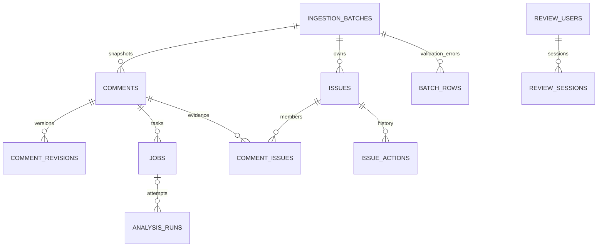

# Architecture / 系统架构

## English

### Scope and workflow

ReviewLens imports product reviews, extracts concrete issues, groups them within an upload,
and lets staff confirm or correct assignments and follow up issues. The full workbench is
served at `/ui/`, with a Chinese/English switch. Review text and evidence keep their original language.

```mermaid
flowchart LR
    UI[Batch upload] --> API[Validate input]
    API --> DB[(Batch snapshots and jobs)]
    DB --> Worker[Worker claims a job]
    Worker --> AI[Model extraction: up to 3 attempts]
    AI --> Fallback[Rules if model fails]
    AI --> Check[Validate categories and evidence]
    Fallback --> Check
    Check --> Group[Same batch, platform, store, product and category]
    Group --> Saved[(Saved results)]
    Saved --> Board[Batch / product / category board]
    Board --> Clear[Grouped entries]
    Board --> Pending[Needs human confirmation]
    Clear --> Review[Human corrections and history]
    Pending --> Review
```

`compose.yaml` runs PostgreSQL, API, Worker and AI separately. The API also serves the frontend.
The independent midterm demo at `/en` and `/zh` on port 18717 keeps its own controller and database;
it does not supply the full product's records.

### Data and batch boundaries

`comments` stores upload occurrences. Its source identity is recognizable by platform, store,
product and source review ID, but uniqueness also includes `batch_id`. Uploading the same source
again creates an independent occurrence and analysis job. A changed review in batch B never
replaces batch A's text, decisions or results. Within one batch, repeated source IDs share one
occurrence; changed text retains revision history. Replaying the same idempotency key and payload
returns the existing batch rather than importing again.

Grouping, manual reassignment, manual additions and merge/split stay within the same batch,
platform, store and product. They may cross categories when a person corrects a classification.
Source data, model output, evidence and human decisions remain separate records.

Migrations end at `20261126_0010`. Migration separates recoverable historical memberships and
flags uploads whose old cross-batch deduplication lost occurrence information. It does not invent
missing historical text. Startup repairs only unreviewed legacy groups from saved output, once per
batch, without model calls. Groups with human decisions/history are preserved.

### Jobs, stop and deletion

```mermaid
stateDiagram-v2
    [*] --> pending
    pending --> claimed: claim; attempts + 1
    claimed --> completed: guarded result commit
    claimed --> pending: retry or expired lease
    claimed --> failed: terminal failure
    pending --> cancelled: stop batch
    claimed --> cancelled: stop batch
```

Claim and result saving lock the batch before its job/comment. Stop takes the same batch lock:
results committed before the cutoff remain; unfinished records become `cancelled`. Late replies
cannot save results, schedule retries, or restore cancelled jobs. An already-sent provider request
may finish remotely. Result pages for a stopped batch show only successfully analyzed reviews;
the imported-record view retains cancelled rows. `no` and `unknown` are successful analysis outcomes.

Trash stops unfinished work and hides the batch from normal lists, catalogs, results and statistics.
Restore keeps record IDs/history and never resumes cancelled work. Permanent deletion removes only
that batch's records. Cross-scope legacy references block deletion rather than cascading into another
batch. Downgrades that would discard independent batch/lifecycle history require a backup restore.

### Categories, grouping and review

| Category | Definition |
| --- | --- |
| Quality | Physical damage, broken parts, jammed zippers, torn seams and fading |
| Delivery | Missing or delayed delivery and address problems |
| Not as described | Size/fit complaints, wrong colour/style, differences from the listing |
| User experience | Comfort and ease of use, excluding size/fit |
| Other | Price/value and concrete issues outside the preceding categories |

Too big, too small and too narrow all belong to `mismatch`; price belongs to `other`.
Different specific problems can share a category without becoming one recurring issue.
Known incompatible failures, such as price versus size or large versus small, are not merged.
MiniLM compares candidates only within the batch/product/category scope. Ambiguous close matches
can link to the best candidate with `requires_review=true`. A grouping outage reuses an exact title
only, or creates a pending group; it no longer merges into the earliest category group.

The board is **batch → product → category → grouped entries → pending entries**. Automatic and
human assignments have separate labels. A pending assignment can be confirmed; either kind can
be reassigned. Accepting an association is separate from confirming or resolving an issue in the
follow-up workflow. Worker reruns preserve human decisions and explicit human grouping.

Catalogs page through the complete active batch/product options. Products are identified by
platform/store/product, and product choices follow selected batches. The board pages whole products;
each category lane loads additional entries separately. Cancelled/trashed records do not inflate results.

### AI Integration Card

| Item | Implementation |
| --- | --- |
| Workflow step | Worker calls `/extract-issues` for a saved batch occurrence, validates output, then requests `/suggest-groups` for local semantic matching. |
| Input minimization | Provider messages contain review text (up to 2,000 characters), category definitions and instructions. Internal batch/comment/store IDs are not added to provider messages. |
| Output contract | `has_issue`: yes/no/unknown. Each issue has a controlled `category_id`, description and verbatim evidence (1–500 characters), and optional confidence from 0 to 1. At most one extracted issue per category per review. |
| Automatic adoption | Requires `source=llm`, confidence ≥0.9, verified evidence, consistent recognized problem/category cues and no ambiguity/fallback flag. Linking an existing group additionally requires similarity ≥0.8. Model confidence alone is insufficient. Otherwise save a pending suggestion. |
| Review states | AI auto-confirmed links use accepted plus `auto_confirmed=true`, without a fabricated human identity. Human decisions clear that flag and retain operator/history. Issue follow-up status remains independent. |
| Fallback | Configured provider failures receive at most two retries (three attempts total); missing configuration falls back immediately. Rule results remain pending. Model/job attempts are separate counters. |
| Provenance | Analysis records retain model/prompt/category versions, input hash, output, source, attempts, fallback reason, latency and grouping hints. Links retain original evidence and review versions. |
| Provider and local alternative | OpenAI-compatible provider configured in ignored local `.env`; the existing course gateway/model remain configurable. Rules provide a key-free alternative; MiniLM grouping runs locally. The updated standard prompt is `review-extraction-v2`. |
| Rate limits | Worker processes one job at a time per process. HTTP 429 participates in bounded model retry/fallback. No global provider request-rate limiter is implemented. |
| Privacy | The Key stays in the provider authentication header. Review text can itself contain personal information; automatic redaction is not implemented. |
| Validation | Tests cover source/evidence checks, five-category rules, automatic/pending assignments, human override, batch isolation, stop races, trash/restore/purge, pagination and bilingual UI behavior. |
| Quality limits | Confidence/similarity thresholds are operational rules, not calibrated accuracy guarantees. Unknown phrasing, sarcasm and unsupported warranty/after-sales expressions can still need human review. |

### Code map

| Area | Files |
| --- | --- |
| Import and lifecycle | `services/api/app/ingestion.py`, `batches.py` |
| Catalog and board | `services/api/app/catalog.py` |
| Worker | `services/worker/app/main.py`, `jobs.py`, `analysis.py`, `policy.py` |
| Extraction/grouping | `services/ai/app/llm.py`, `main.py`, `english.py`, `grouping.py` |
| Category policy | `services/common/classification.py`, `categories.py` |
| Human decisions | `services/api/app/reviews/` |
| Frontend | `frontend/scope-filter.js`, `scope-pages.js`, `batch-actions.js`, existing review modules |

## 中文

### 范围与流程

ReviewLens 导入商品评论、提取具体问题，在各批次内归组，再由工作人员确认或调整归组并跟进问题。
完整工作台入口为 `/ui/`，支持中英文切换。评论原文和证据保留原语言。

流程为：上传与校验 → 保存批次评论及任务 → Worker 领取 → 大模型提取（失败后规则备用）→
检查类别与原文证据 → 同批次商品内归组 → 保存结果 → 按批次／商品／类别展示 → 人工确认与调整。

`compose.yaml` 分别运行 PostgreSQL、API、Worker 和 AI，API 同时提供前端。
18717 端口的 `/en`、`/zh` 期中 Demo 继续使用独立控制器和数据库，不提供完整产品的数据。

### 数据与批次边界

`comments` 保存评论在一次上传中的记录。平台、店铺、商品和来源评论编号可以识别来源，但唯一性还包括
`batch_id`。再次上传同一来源，会建立属于新批次的评论记录和分析任务；B 批次不会覆盖 A 的正文、决定或结果。
同批次重复来源共用一条记录，正文变化保留版本。相同幂等编号和内容的请求重试返回已有批次，不重复导入。

批次拥有评论、问题组和校验记录；评论拥有版本、任务及分析记录；评论与问题组通过证据关联连接，人工操作另存历史。
归组、人工移动、补充问题和合并／拆分均限定在同批次、同平台、同店铺、同商品内；人工纠错可以跨类别。

数据库迁移到 `20261126_0010`。迁移拆开能够还原的历史关联，并标记旧版去重导致记录缺失的批次，不伪造历史正文。
启动时按批次执行一次旧结果整理，只使用已保存输出，不调用模型；有人工决定或历史的问题组保持原样。

### 任务、停止与删除

任务正常经过 `pending → claimed → completed`，异常可重试或最终失败。
领取和保存按“批次 → 任务 → 评论”加锁。停止操作使用同一个批次锁：截止前已保存的结果保留，未完成记录标为
`cancelled`。迟到结果不能落库、重试或恢复任务；已发送的外部模型请求可能仍在提供方完成。

已停止批次的结果页只显示成功完成分析的评论；原始导入记录仍可查看取消状态。
`no` 和 `unknown` 都属于成功完成分析，不是任务失败。

移到回收站时先停止剩余分析，并从正常列表、选项、结果和统计中移除。恢复保留编号和历史，不恢复已取消任务。
永久删除仅清除该批次内容；遇到历史跨范围引用时阻止删除，避免影响其他批次。
不能无损回退的新批次或生命周期数据，需要通过备份恢复，不能强行降级丢失历史。

### 分类、归组与复核

| 类别 | 定义 |
| --- | --- |
| 质量 | 破损、零件失效、拉链卡住、开线、掉色等 |
| 物流 | 未收到、配送延迟、地址问题等 |
| 描述不符 | 尺码／合身度、颜色或款式错误、与商品描述不一致 |
| 使用体验 | 舒适性和使用便利性，不包含尺码问题 |
| 其他 | 价格、性价比及上述类别之外的具体问题 |

偏大、偏小、偏窄都归入“描述不符”，价格归入“其他”。同类别可以有不同具体问题；价格与尺码、偏大与偏小等
已知不同问题不会仅因相似度高而合并。MiniLM 只比较同批次商品类别内的候选。
多个候选接近时可以建议放入最接近的组，同时标记待人工确认。归组服务失败时只复用完全一致的标题，或建立待确认组，
不再直接放入该类别最早的问题组。

页面层级为“批次 → 商品 → 类别 → 上方已归组 → 下方待确认”。已归组分别标明 AI 自动确认、人工确认或人工调整。
待确认内容可以人工确认，两种内容都可调整归组。关联接受与整个问题的确认、处理完成分别记录，后台重跑保留人工决定。

批次和商品选项完整分页读取；商品由平台、店铺和商品编号共同区分，并随批次选择联动。
问题看板按完整商品分页，类别内另行加载更多关联。取消及回收站记录不计入正常结果。

### AI 接入卡片

| 项目 | 实现 |
| --- | --- |
| 工作流步骤 | Worker 对已保存的批次评论调用 `/extract-issues`，校验后再通过 `/suggest-groups` 进行本地语义匹配。 |
| 最小化输入 | 外部模型收到评论正文（最多 2,000 字符）、类别定义及说明，不额外发送内部批次、评论、店铺编号。 |
| 输出约定 | `has_issue` 为 yes/no/unknown；问题包含受控类别、1–500 字符的描述和原文证据，以及可选的 0–1 置信度。每条评论每个类别最多提取一个问题。 |
| 自动采用条件 | 来源必须是 `llm`，置信度至少 0.9；原文证据有效，已识别的具体问题与类别一致，没有模糊或回退标记。关联已有组还要求相似度至少 0.8。不能只凭模型自报置信度通过；其余保存为待确认建议。 |
| 复核状态 | AI 自动确认使用 accepted 和 `auto_confirmed=true`，不伪造人工身份；人工决定清除此标记并保存操作者及历史。问题跟进状态独立记录。 |
| 回退 | 已配置模型失败后最多重试两次，共三次；缺少配置立即回退规则。规则结果仍待人工确认；模型尝试和任务尝试分别计数。 |
| 来源追踪 | 分析记录保留模型／提示词／类别版本、输入哈希、输出、来源、次数、回退原因、耗时和归组信息；关联保留原文证据和复核版本。 |
| 提供方与本地替代 | OpenAI 兼容提供方由已忽略的本地 `.env` 配置，课程网关及模型继续可配置；规则不需要 Key，MiniLM 在本地运行。更新后的标准提示词为 `review-extraction-v2`。 |
| 限流 | 每个 Worker 进程顺序处理任务；429 进入有限模型重试及回退，尚未实现全局提供方请求限流器。 |
| 隐私 | Key 位于提供方认证请求头；评论自身可能含个人信息，尚未自动脱敏。 |
| 验证 | 覆盖输入／证据校验、五类规则、自动与待确认归组、人工纠错、批次隔离、停止并发、回收／恢复／删除、分页及双语页面。 |
| 质量边界 | 置信度和相似度阈值是运行规则，不等于已校准的准确率。未知表达、反讽及规则不支持的保修／售后表达仍可能需要人工核对。 |

### 代码位置

导入及批次操作位于 `services/api/app/ingestion.py`、`batches.py`；选项和看板位于 `catalog.py`。
后台编排和保存位于 `services/worker/app/`；模型、规则和语义归组位于 `services/ai/app/`；
五类定义及检查位于 `services/common/classification.py`、`categories.py`；人工流程位于 `services/api/app/reviews/`。
前端由新增的 `scope-filter.js`、`scope-pages.js`、`batch-actions.js` 与原有复核模块共同组成。
