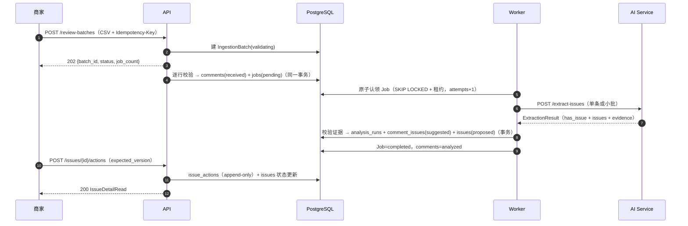
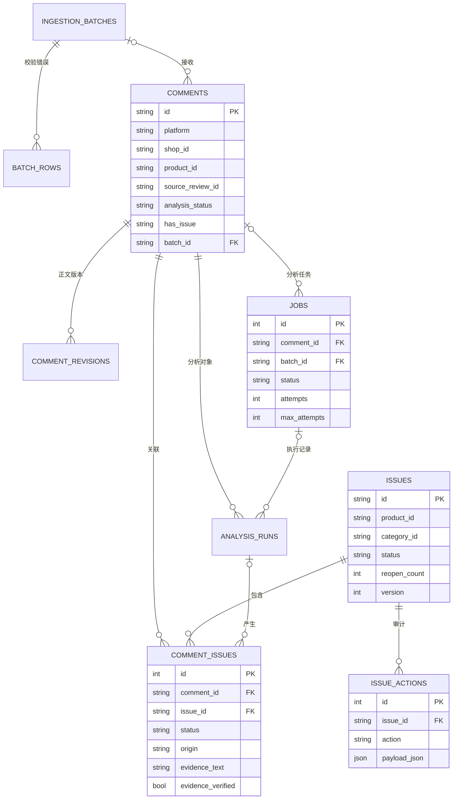
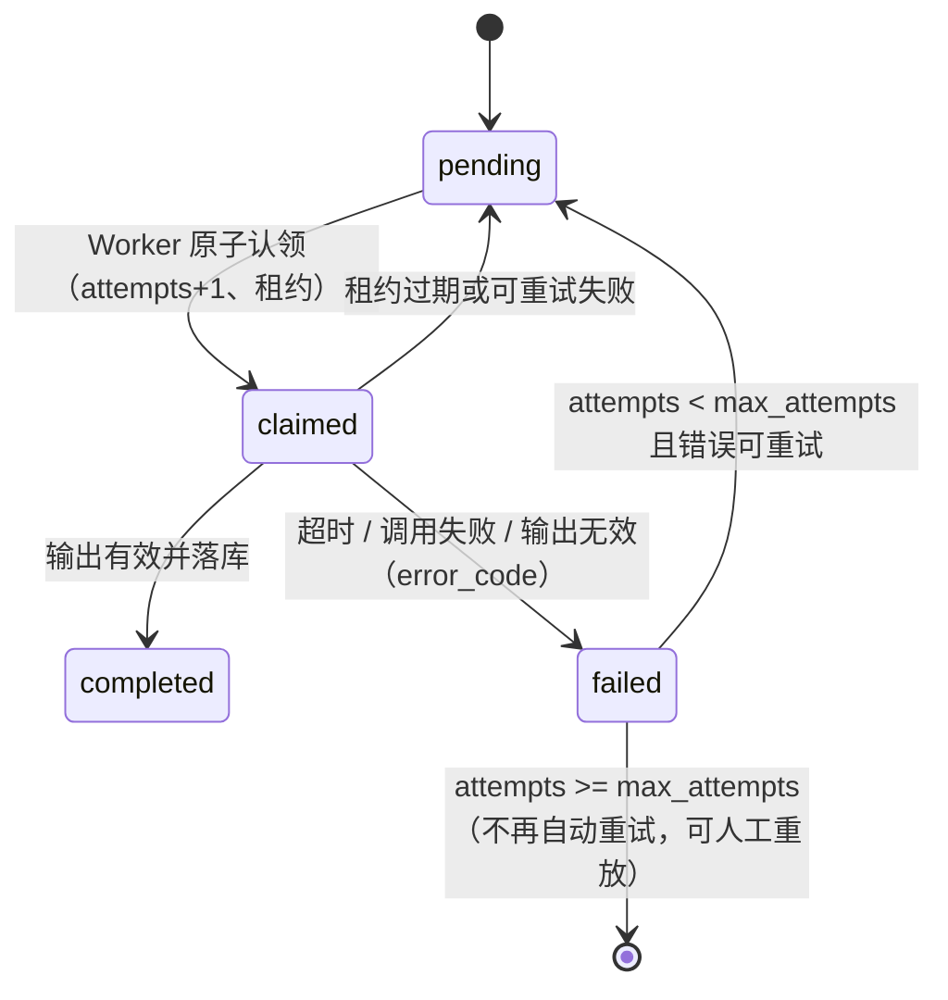
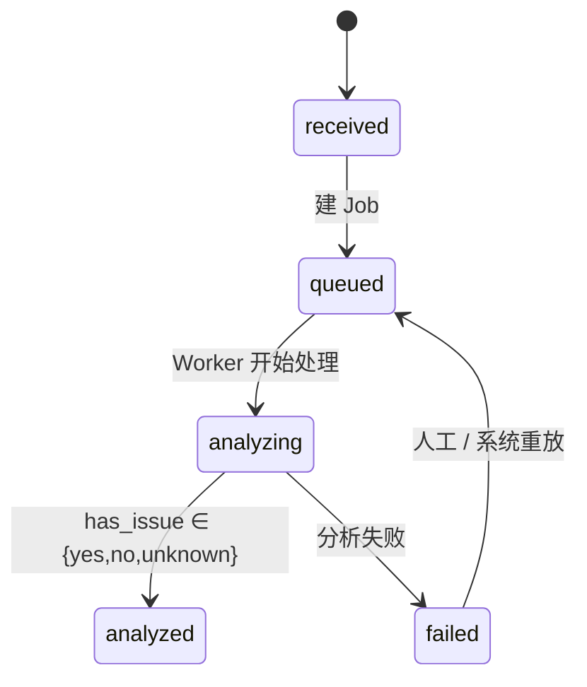
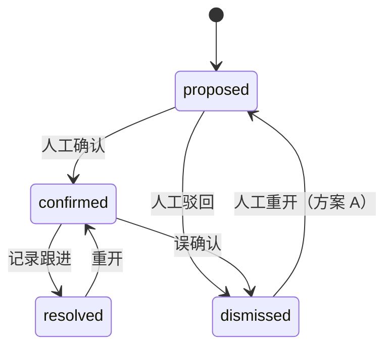
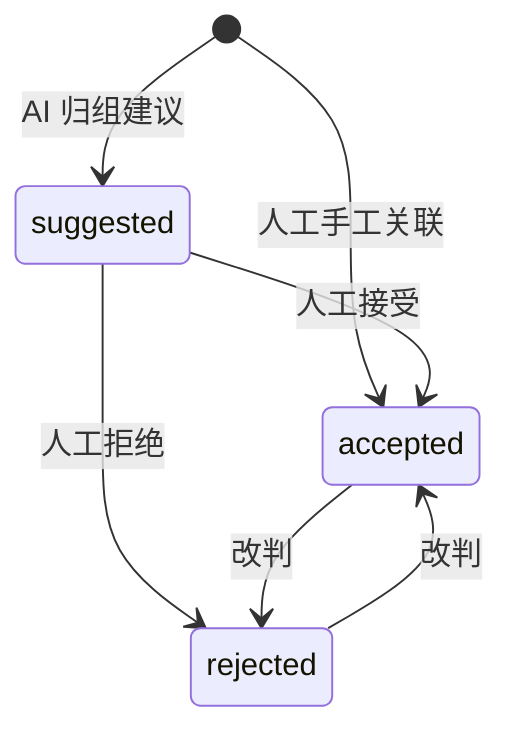

# 商品评论管理与重复问题发现系统 — 系统架构（单平台初版）

> 本文档是 Proposal《商品评论管理与重复问题发现系统（单平台初版）》的技术落地版本，
> 对应评审报告 `review/系统设计评审与四人分工.md` 的 §4「修订后的目标架构」。
> 所有状态、字段、接口、约束以本文为准；与 Proposal 原文冲突处，以本文的修订说明为准。
>
> 当前实现进度：数据模型 `services/common/models.py`、契约
> `services/common/schemas.py`、迁移 `20261027_0002` + `20261027_0003`、R1 的批次接入
> （`services/api/app/ingestion.py` + API）、Worker/AI 规则基线、静态 UI（`frontend/`，
> `/ui`）已可运行；R2/R3/R4 按 `docs/team-division.md` 的分工继续推进。

图 1 位于 `docs/assets/fig1_end_to_end_flow.png`。

---

## 1. 问题与主要用户（Problem and Primary User）

商家需要从商品评论中了解质量、使用体验和物流等问题，但评论表达零散、措辞各异
（"拉链拉不上""开合时卡住""拉到一半就动不了"可能指向同一个问题），逐条阅读与
手工汇总成本高，单看评分或情绪分类也无法判断该跟进什么。

本系统把选定平台（首版只接一个平台）的商品评论集中接收、逐条分析、把**同一商品内
含义相近的问题**归成候选问题组，供运营人员复核与跟进。系统只提供线索与整理，
**不判定产品缺陷、责任或根因，也不向原平台执行任何操作**。

主要用户：选定平台上具有一定评论量的电商商家、商品运营人员、售后负责人。
演示聚焦箱包类商品（拉链、肩带、容量、色差），便于人工核对。

## 2. 范围与边界（Scope and Boundaries）

### 2.1 首版范围内

- 单平台、单数据入口：CSV 导入 **或** 官方授权接口拉取（二选一，开发前先验证入口）。
- 评论批量接收、校验、去重、集中查询与筛选。
- AI 逐条提取具体问题（类别 + 描述 + 原文证据），区分"有 / 无 / 无法判断"。
- 同一商品内归组：关联已有问题组或新建候选组，人工确认 / 驳回 / 改名 / 合并 / 拆分。
- 人工记录跟进措施与问题组状态；保留完整复核审计。
- 失败可见、可重试、可人工重放；统计口径可解释。

### 2.2 明确不做（首版）

- 不接第二个平台，不做跨平台商品匹配，不做多店铺授权与团队权限。
- 不自行开发爬虫、浏览器插件或第三方采集工具。
- 不处理图片、视频、音频评论；只处理文字正文。
- 不自动判定缺陷 / 责任 / 根因，不自动退款、召回、下架、回复或删除评论。
- 不做异常预测、复杂优先级排序、模型训练。
- 不承诺毫秒级实时同步或全量历史覆盖。

## 3. 设计原则（Design Principles）

1. **事实与推断分离**：评论原文、来源、日期是不可变事实；AI 的问题提取与归组是推断，
   必须挂原文证据、可被人工推翻。
2. **AI 提供线索，人做判断**：AI 只写 `suggested` 关联；`accepted` / `rejected` 只能由
   人工动作写入，且永不因重跑被覆盖。
3. **提交即返回、后台处理、失败可见**：批次接收返回 202；分析在 Worker 中进行；
   失败写 `error_code`，结果不伪造。
4. **可追溯**：每次 AI 执行落 `analysis_runs`（模型 / prompt / 原始输出）；每次人工动作
   写 `issue_actions`（append-only）。
5. **范围收敛**：单平台、单入口、单商品域；扩展只留适配层与字段，不提前写多平台代码。
6. **统计诚实**：区分接收量 / 成功分析量 / 失败量；问题数量是"提及该问题的去重评论数"，
   不称为缺陷率或退货率。

## 4. 主流程（Primary Workflow）


### 4.1 端到端步骤（与图 1 编号一致）

1. **数据来源**：商家导出 CSV 或通过官方授权接口拉取（首版二选一；不做采集工具）。
2. **接收批次**：`POST /review-batches`（带 `Idempotency-Key`）建 `IngestionBatch`
   （`status=validating`），返回 `202 {batch_id, status, declared_rows}`；`job_count` 在
   逐行校验完成后由 `GET /review-batches/{id}`（`BatchProgressRead`）给出，不返回单个 job id。
3. **校验与规范化**：编码 / 必填字段 / 行数上限（≤5,000 行、≤10 MB、正文 ≤2,000 字符）；
   错误行写 `batch_rows`（行号 + 字段 + 原因），可下载；校验失败可修正后**重传生成新批次**
   （记 `resubmitted_from_batch_id`，不覆盖旧批次）。
4. **有效行入库**：统一为 `NormalizedComment` → 写 `comments`（`analysis_status=queued`）
   与 `jobs`（`pending`、`job_type=extract_issues`），**同一事务**；批次置 `imported`。
5. **Worker 认领**：`SELECT … FOR UPDATE SKIP LOCKED`（或 `UPDATE … RETURNING`）原子认领，
   写 `claimed_at`、`lease_expires_at`，`attempts+1`；完成 / 失败写入带 fencing 条件。
6. **AI 提取**：调用 `/extract-issues`（单条或 20–50 条小批），按 §9.2 校验 JSON Schema 与
   证据子串；无效结果不落库。
7. **结果落库**：写 `analysis_runs` + `comment_issues(suggested)` + `issues(proposed)`；
   评论置 `analyzed`、Job 置 `completed`（同一事务，`has_issue` 三态）。
8. **归组后处理**（可重跑）：按 `(product_id, category_id)` 召回 `proposed/confirmed` 组，
   命中则 upsert 关联，未命中建新组；组内去重靠应用层 + advisory lock，关联重复靠
   `uq_comment_issues_pair` 兜底（`issues` 本身没有唯一约束）。
9. **人工复核**：问题组看板按商品 / 日期 / 类别 / 状态筛选，展示 AI 建议数、人工确认数、
   原文证据。
10. **复核动作**：确认 / 驳回 / 改名 / 合并 / 拆分 / 记录跟进 / 重开，全部写
    `issue_actions`（append-only），`expected_version` 乐观锁防并发覆盖。
11. **终态与关组**：`resolved`（已记录处理）或 `dismissed`（可人工重开）；关组后新评论
    只生成 `suggested` 关联并提示人工，**不自动重开、不计入人工确认数**。
12. **统计**：接收量 / 成功分析量 / 失败量 / 问题提及数（`accepted` 去重）/ 分析覆盖率；
    所有查询接口返回 `as_of` 与查询范围。

### 4.2 批次语义与"部分成功"

- **1 条评论 : 1 个 Job**。Job 是 AI 调用、重试、幂等的最小单元；批次只做接收与汇总。
- 同一评论同时最多一个非终态 Job（数据库部分唯一索引 `uq_jobs_active_comment`）。
- 批内某条失败不影响其他评论；批次进度由 Job 聚合实时派生，**不在批次表另存计数**
  （避免双真相）：`accepted_rows` / `duplicate_rows` / `invalid_rows` 只表示导入阶段；
  `analyzed_rows` / `failed_rows` 由 `jobs` / `comments.analysis_status` 实时统计。
- 批次 `status` 的持久化值只表示**导入阶段**：`received → validating → imported`，
  校验不通过为 `rejected`。`completed / partially_failed` **不写库**，由
  `GET /review-batches/{id}` 读时按 Job 聚合派生（单写者原则，避免双写竞争与"已导入
  但页面显示完成"的双真相）。
- 派生规则：所有 Job 终态后，若 `invalid_rows + failed_rows > 0` 则为 `partially_failed`，
  否则为 `completed`；仍有非终态 Job 时返回 `imported` 并附 `pending_rows/processing_rows`。
- 关组后收到的新评论仍正常入库与分析，只生成 `suggested` 关联并计入"关组后新增数"，
  不计入人工确认数，也不自动重开问题组。

### 4.3 去重与更新规则

- **去重键**：`UNIQUE(platform, shop_id, product_id, source_review_id)`。来源编号的作用域
  （平台 / 店铺 / 商品）需在入口验证阶段确认。
- **无稳定编号时的契约**：入口层合成 `source_review_id = "synth:<sha1(platform|shop|
  product|content_hash|review_date)>"`（绝不伪造真实编号），同时置
  `dedupe_mode=content_hash`；命中去重时只写 `duplicate_of_id`（疑似重复）并保留记录，
  **不物理删除**，交人工判重。
- **正文变更**：追加 `comment_revisions`（`version` 自增），重新分析；旧关联不覆盖人工结论，
  重新计算统计。不承诺发现全部历史变更。
- **正文哈希复用**：`comment_issues.comment_version` 记录结论对应的正文版本；
  `content_hash` 用于检测正文是否变化与缓存句向量。
- **重传 / 重试 / 重跑**：均不得重复计数；`comment_issues` 唯一约束
  `(comment_id, issue_id)` 兜底。

## 5. 组件与架构流（Components and Architecture Flow）

### 5.1 组件

| 组件 | 职责 | 代码位置（目标） |
| --- | --- | --- |
| API（FastAPI） | 批次接收与校验、评论查询、问题组与复核动作、任务状态、健康与指标；写操作事务化 | `services/api/app/` |
| Ingestion（API 内） | 编码与列映射、逐行校验、去重 upsert、错误清单落库、批次状态机 | `services/api/app/ingestion.py` |
| Worker | 原子认领 Job（租约）、逐条分析、写 `analysis_runs` 与关联、失败分类与重试、指标 | `services/worker/app/` |
| AI Service | `/extract-issues`（单条或小批）、`/suggest-groups`（同商品归组建议）；规则基线可替换为 LLM | `services/ai/app/` |
| Static UI | 批次 / 评论 / 问题组 / 复核 / 关于五页；问题组页含筛选/搜索/状态卡片/详情（mock 数据） | `frontend/`（挂载于 API `/ui`） |
| PostgreSQL | 事实表、推断表、审计表、任务表（§6） | — |
| Source Adapter | `CsvSourceAdapter`（首版）、未来 `ApiSourceAdapter`；输出统一 `NormalizedComment` | `services/api/app/ingestion.py` |
| Docker Compose | 本地四服务编排 + 可选 Prometheus | `compose.yaml` |

### 5.2 请求时序



### 5.3 分层与依赖

```
API ──> PostgreSQL <── Worker ──> AI Service
 │                          │
 └─ schemas.py（共享契约）<──┘
```
- 三端共享 `services/common/schemas.py` 与 `models.py`，契约变更必须 PR 评审。
- API 不直接调 AI；Worker 不处理 HTTP 请求；AI 服务不访问数据库。

## 6. 持久化实体与 ERD（Persistent Entities and Schema/ERD）

### 6.1 ERD



### 6.2 表与关键字段

分四类：**事实**（评论、版本、批次、错误行）、**推断**（问题组、评论关联）、
**审计**（复核动作、分析执行）、**任务**（Job）。完整字段见
`services/common/models.py`；迁移见 `20261027_0002` / `20261027_0003`。

| 表 | 关键字段 | 约束 / 索引 |
| --- | --- | --- |
| `ingestion_batches` | id, platform, source_type, file_ref, file_hash, declared_rows, accepted_rows, duplicate_rows, invalid_rows, status, idempotency_key, resubmitted_from_batch_id, created_at, finished_at | `uq_ingestion_batches_idempotency_key`；status 枚举 CHECK；`(status, created_at)` |
| `batch_rows` | id, batch_id, row_number, column_name, code, message, created_at | `(batch_id, row_number)`；FK CASCADE |
| `comments` | id, platform, shop_id, product_id, source_review_id, batch_id, rating, review_date, body, content_hash, dedupe_mode, duplicate_of_id, analysis_status, has_issue, current_analysis_run_id, analysis_error, created_at, updated_at | `uq_comments_source`；`(product_id, review_date)`；`analysis_status` / `batch_id` 索引；枚举 CHECK |
| `comment_revisions` | id, comment_id, version, body, content_hash, created_at | `UNIQUE(comment_id, version)`；FK CASCADE |
| `jobs` | id, comment_id, batch_id, job_type, status, attempts, max_attempts, next_attempt_at, lease_expires_at, error_code, error, created_at, claimed_at, completed_at, updated_at | `comment_id` 非空；`uq_jobs_active_comment`（部分唯一：`comment_id` 且 status ∈ pending/claimed）；`(status, next_attempt_at)`；CHECK：`ck_jobs_status`、`ck_jobs_job_type`（仅 `extract_issues`） |
| `analysis_runs` | id, job_id, comment_id, model_version, prompt_version, category_version, input_hash, output_json, status, error_code, latency_ms, token_in, token_out, created_at | `(comment_id, created_at)`；status CHECK |
| `issues` | id, platform, shop_id, product_id, category_id, title, description, status, created_by, merged_into_id, split_from_id, reopen_count, version, resolved_at, created_at, updated_at | `(product_id, status)`、`(product_id, category_id)`、`(status, updated_at)`；状态 / created_by CHECK |
| `comment_issues` | id, comment_id, issue_id, status, origin, evidence_text, evidence_start, evidence_end, evidence_verified, similarity, analysis_run_id, comment_version, superseded_at, decided_by, decided_at, created_at, updated_at | `UNIQUE(comment_id, issue_id)`；`(issue_id, status)`；status / origin CHECK |
| `issue_actions` | id, issue_id, comment_issue_id, action, from_status, to_status, payload_json, operator, note, created_at | `(issue_id, created_at)`；action 枚举 CHECK；**append-only** |

### 6.3 建模约定

- 主键：`comments` / `issues` / `ingestion_batches` 用 UUID 字符串；明细表用自增整数。
- 时间：全部 `TIMESTAMP WITH TIME ZONE`；统计与筛选用 `review_date`，缺失回退
  `created_at` 并在接口返回 `date_basis`。
- 状态枚举用 `String + CHECK`（而非 PG ENUM），便于测试与演进。`jobs.comment_id` 非空、
  `job_type` 只允许 `extract_issues`，一条评论同时最多一个非终态 Job（部分唯一索引）。
  `error_code` 保持应用层枚举（便于扩展新错误，不建 DB CHECK）。
- `attempts` 计认领次数：Worker 仅在真正认领时 +1，租约回收不增加；人工重放时清零并写审计。
- `comments.current_analysis_run_id` 不建 FK（与 `analysis_runs.comment_id` 循环），
  由应用维护；其余关联均建 FK。
- 评分：`rating` 仅作筛选与展示，不参与问题判定。
- ORM 删除语义：数据库 FK 为 `ON DELETE CASCADE` 的父子关系，ORM 侧配 `passive_deletes`，
  由数据库执行级联，避免 ORM 先把外键置空。

## 7. 状态机（State Transitions）

### 7.1 分析任务 Job



| 迁移 | 触发者 | 必须同时写入 |
| --- | --- | --- |
| pending → claimed | Worker（`SKIP LOCKED`） | `claimed_at`、`lease_expires_at`、`attempts+1` |
| claimed → completed | Worker | `completed_at`；结果与状态同事务；fencing 校验 |
| claimed → failed | Worker | `completed_at`、`error_code`、脱敏 `error` |
| failed → pending | Worker 扫描（`attempts < max_attempts`）或 `POST /jobs/{id}/retry`（人工，重置 attempts 并记审计） | `next_attempt_at`；仅可重试错误 |
| claimed → pending | 租约巡检 / `POST /jobs/{id}/recover` | attempts 不增加、记 `lease_expired` |

> R2 实现将 attempts 统一为实际认领次数：仅认领 +1，回收不增加。自动重试回 pending，并以 next_attempt_at 控制领取时间。

**禁止** `failed → claimed`：`claimed` 只表示"正在处理"，重试必须回 `pending`。

### 7.2 评论分析状态



统计口径：`received/queued/analyzing` = 处理中；`analyzed` = 成功分析；`failed` = 失败。
`has_issue=unknown` 计入成功分析，但不计入问题数量。

### 7.3 问题组 Issue



- `resolved` / `dismissed` 是**关闭态**，不是绝对终态：`dismissed` 允许人工重开，
  `resolved` 允许重开；两者都不因新评论自动改变状态。
- 改名 / 合并 / 拆分只改属性与关联，**不改变 status**，全部写 `issue_actions`。
- 合并：目标组吸收来源组的 `comment_issues`，来源组置 `merged_into_id` 并从活跃列表排除。
  **冲突规则**：两组都含同一评论时，保留优先级 `accepted > rejected > suggested` 的行
  （`origin=human` 优先于 `origin=ai`），被丢弃的行写
  `issue_actions(action=merge_into, payload_json={dropped_link_ids: [...]})`；实现用
  `ON CONFLICT (comment_id, issue_id) DO UPDATE` 而不是先删后插。
- 拆分：新建 N 个组，按 `IssueActionRequest.comment_issue_ids` 迁移选定关联，记
  `split_from_id`；原组保留并写审计。

### 7.4 评论关联 CommentIssue



- `accepted` 是唯一进入"问题提及数"的状态。
- AI 只写 `origin=ai, status=suggested`；人工决定写 `origin=human` 或改 `status` 并记
  `decided_by / decided_at`。
- 重跑只 supersede `origin=ai AND status=suggested` 的行，**不触碰** `accepted/rejected`。

### 7.5 状态联动规则

1. 评论 `analysis_status=failed` 时，`Job` 必为 `failed`（`error_code` 对齐）。
2. `Issue` 为 `resolved/dismissed` 时，新 AI 建议只落 `suggested` 并提示，不自动改状态。
3. 一组内 `accepted` 改判归零时，`Issue` 不自动驳回，只提示人工决定。
4. `Job` 完成不等于业务解决：`completed` 只表示该条分析成功。

## 8. 接口与服务边界（API/Service Boundaries）

### 8.1 对外接口

| # | 接口 | 作用 | 关键约定 |
| --- | --- | --- | --- |
| 1 | `POST /review-batches` | 上传 CSV / JSON 批次 | JSON 内嵌 `csv_text` 或 `comments` + `Idempotency-Key`；返回 `BatchCreateResponse`（202）；multipart 文件上传待接入 |
| 2 | `GET /review-batches/{id}` | 批次进度与计数 | `BatchProgressRead`：导入计数 + `analyzed/failed/pending/processing` + `analysis_coverage` + `scope`（含 `as_of`） |
| 3 | `GET /review-batches/{id}/errors` | 错误清单 | `BatchErrorRead` 列表（CSV 导出待补） |
| 4 | `GET /comments` | 评论列表 | 商品 / `analysis_status` / `has_issue` + `limit/offset`（cursor 优化待补），返回 `scope` |
| 5 | `GET /comments/{id}` | 评论详情 | `CommentDetailRead`：原文、`revisions`、`latest_analysis_run`、关联问题与证据 |
| 6 | `GET /issues` | 问题组列表 | 商品 / 状态 / 类别 + `limit/offset`，附 `suggested/accepted` 计数 |
| 7 | `GET /issues/{id}` | 问题组详情 | `IssueDetailRead`：关联评论 + 证据 + 计数口径 + actions 历史 |
| 8 | `POST /issues/{id}/actions` | 复核动作 | `IssueActionRequest`；`expected_version` 冲突返回 409（R4 实现） |
| 9 | `POST /comment-issues/{id}/decision` | 关联决策 | accept / reject / change；`LinkDecisionRequest`（R4 实现） |
| 10 | `GET /jobs/{id}` | 单任务状态 | `AnalysisJobRead`（attempts、next_attempt_at、error_code） |
| 11 | `POST /jobs/{id}/retry` | 人工重放 | failed 可人工重放（重置 attempts，记审计）；自动重试仍受 `max_attempts` 限制（R2 实现） |
| 12 | `POST /jobs/{id}/recover` | 卡死回收 | 仅 claimed 且租约过期；写 `lease_expired`，回 pending（R2 实现） |
| 13 | `GET /stats/summary` | 统计汇总 | `StatsSummaryRead`：§11 各项 + `scope(as_of)`；当前支持 `product_id`，日期过滤待补 |
| 14 | `/health/live`、`/health/ready`、`/metrics` | 运维 | 沿用现状，补 worker 指标 |
| 15 | `/ui/` | 静态前端 | `frontend/` 由 API 挂载，当前提供五页导航 + mock 数据 |

可选：`POST /comments/{id}/reanalyze`（人工触发单条重跑），在 P1 阶段实现。

### 8.2 内部 AI 接口

- `POST /extract-issues`：`ExtractionRequest → ExtractionResult`（§9.2）。
- `POST /suggest-groups`：`GroupSuggestionRequest → GroupSuggestionResult`（同商品归组建议）。

### 8.3 错误码与幂等

| 场景 | 状态码 | 约定 |
| --- | --- | --- |
| 参数 / 字段错误 | 422 | `{field, reason}` 数组；批次行错误进 `batch_rows` |
| 文件过大 / 行数超限 | 413 / 422 | 提示拆分批次 |
| 资源不存在 | 404 | 统一错误体 `{code, message, request_id}` |
| 状态迁移非法 / 版本冲突 / 重复重试 | 409 | 返回当前状态与 `version` |
| 限流 | 429 | 带 `Retry-After` |

- 写接口支持 `Idempotency-Key`；同键重复提交返回首次结果。
- 复核动作带 `expected_version`（`issues.version`），不一致返回 409，前端刷新后重试。

## 9. Worker 与 AI 处理（Worker and AI-Enabled Processing）

### 9.1 认领、租约与 fencing

- 认领：`SELECT … WHERE status='pending' AND (next_attempt_at IS NULL OR next_attempt_at<=now())
  ORDER BY created_at FOR UPDATE SKIP LOCKED LIMIT 1`，或 `UPDATE … RETURNING *`；
  置 `claimed`、`claimed_at=now()`、`lease_expires_at=now()+10min`、`attempts+=1`。
- 完成 / 失败写入必须带条件：`WHERE status='claimed' AND claimed_at=:seen_claimed_at`；
  过期 Worker 的提交被拒绝（记 warning，不覆盖）。
- 租约巡检：独立循环（或 `scripts/recover_stale_jobs.py`）把过期 `claimed` 退回 `pending`，
  `attempts+1`，记 `lease_expired`。
- 进程收到 SIGTERM 时处理完当前 Job 再退出，避免制造卡死。

### 9.2 AI 契约与证据校验

```json
{
  "comment_id": "uuid",
  "has_issue": "yes | no | unknown",
  "issues": [
    {"category_id": "quality", "description": "拉链卡住/拉不上", "evidence_text": "拉到一半就动不了"}
  ],
  "model_version": "mock-1",
  "prompt_version": "v1",
  "category_version": "v1",
  "schema_version": "1"
}
```

校验规则（Worker 侧，`ExtractionResult` 已内置部分）：

1. `has_issue=no ⇒ issues=[]`；`has_issue=yes ⇒ issues 非空`；`unknown` 允许两者。
2. `evidence_text` 必须是规范化正文（统一全半角 / 空白）的**精确子串**；Worker 计算
   `evidence_start/end` 并写 `evidence_verified=true`；定位失败则丢弃该 issue、
   `has_issue` 降级 `unknown`、Job 记 warning（不直接 failed、不写无法定位的证据）。
3. `category_id` 来自受控类别常量表 `services/common/categories.py`（质量 / 物流 /
   描述不符 / 使用体验 / 其他，附带 `CATEGORY_VERSION` 常量）；每次分析的类别版本记入
   `analysis_runs.category_version`。首版不做后台维护界面；需要非开发维护时再升级为
   `categories` 表（`category_id` 已是字符串列，无需改契约）。
4. 每次调用必落 `analysis_runs`（模型、prompt、输入 hash、原始输出、耗时、token）。
5. 一条评论多个问题：每个 issue 独立一行 `comment_issues`，各自定位证据；同一问题只计一次。

### 9.3 归组后处理

- 范围：同一 `product_id` 内，先按 `category_id` 召回 `proposed/confirmed` 组。
- 判定：规则基线（关键词 / 同义词）→ 句向量相似度（阈值来自人工标注样本）→ 可选模型裁决；
  相似度不是概率，只作排序与解释。
- 写入：命中已有组则 upsert `comment_issues(origin=ai, status=suggested)`；否则新建
  `issues(created_by=ai, status=proposed)`。并发用 `(product_id, category_id)` advisory lock +
  应用层去重（同 `product + category` 下标题/代表文本相同视为同组）；`issues` 没有唯一约束，
  唯一性由锁与去重逻辑保证，关联重复由 `uq_comment_issues_pair` 兜底。
- 可重跑：归组是独立后处理步骤，重跑只把旧 `origin=ai AND status=suggested` 行写
  `superseded_at`（不 DELETE），人工结论不变。

### 9.4 成本与批量

- AI 调用按 20–50 条 / 批，超时 20s，最多 3 次尝试；记录 token 与调用次数。
- `has_issue=no` 的评论不参与后续归组，避免无谓调用。
- 句向量可缓存（按 `content_hash`），重跑前预估调用量。

## 10. 失败、重试与人工兜底（Failure, Retry and Recovery）

### 10.1 错误分类

| `error_code` | 含义 | 可重试 | 处理 |
| --- | --- | --- | --- |
| `ai_timeout` | AI 超时 | 是 | 退避后回 pending |
| `ai_error` | AI 5xx / 连接失败 | 是 | 退避后回 pending |
| `ai_invalid_output` | JSON / 编号 / 类别校验失败 | 一次性 | 修复提示重试一次；仍失败则 failed |
| `db_error` | 数据库错误 | 是 | 记录并重试 |
| `lease_expired` | Worker 中断 / 租约过期 | 是 | 巡检回收，attempts+1 |
| `comment_not_found` | 评论被删除 | 否 | failed 终态 |
| `unknown` | 未分类 | 否 | failed 终态，人工排查 |

### 10.2 重试与恢复策略

- 自动重试：`max_attempts=3`（可配置），指数退避（1 / 5 / 15 分钟），写 `next_attempt_at`。
- 人工重放：`POST /jobs/{id}/retry` 对 failed 生效（重置 `attempts=0` 并写审计），不受
  `max_attempts` 限制；批量重放用 `scripts/requeue_batch.py --batch-id ... --status failed`。
- 卡死回收：`scripts/recover_stale_jobs.py`（按 `lease_expires_at`）或 `POST /jobs/{id}/recover`。
- 失败不伪造结果：AI 不可用时 Job `failed`、评论 `analysis_status=failed`，页面可见；
  **不写入任何推测结果**。

### 10.3 人工兜底

- 已被 AI 判定 `unknown` 或证据无法定位的评论，在页面标"需人工查看"。
- 人工可对评论手工关联问题组（`origin=human, status=accepted`），也计入问题提及数。
- 所有失败与人工动作均有审计记录，可回溯。

## 11. 统计口径（Counting Rules）

| 指标 | 定义 | 说明 |
| --- | --- | --- |
| 接收量 | `SUM(batch.accepted_rows)` | 重复行单列 `duplicate_rows`；无效行单列 `invalid_rows` |
| 成功分析量 | `COUNT(comments WHERE analysis_status='analyzed')` | 含 `has_issue=unknown` |
| 失败量 | `COUNT(comments WHERE analysis_status='failed')` | 不含处理中 |
| 处理中 | `analysis_status ∈ {received,queued,analyzing}` | 与超时处理中分开展示 |
| 问题提及数 | `COUNT(DISTINCT comment_id) FROM comment_issues WHERE issue_id=? AND status='accepted'` | 同一评论对同一问题只计一次 |
| AI 建议数 | `COUNT(comment_issues WHERE origin='ai')` | 其中 `suggested` 单列 |
| 人工确认数 | `COUNT(comment_issues WHERE status='accepted')` | 页面与"AI 建议数"分开显示 |
| 关组后新增数 | `COUNT(comment_issues WHERE issue_id=? AND origin='ai' AND status='suggested' AND created_at > issue.closed_at)` | 仅提示，不进人工确认数、不自动重开 |
| 分析覆盖率 | 成功分析量 / 接收量 | 占比分母必须同商品、同时间范围 |

约束：所有接口返回 `as_of` 与 `scope(product_id, date_from, date_to)`；不把评论数量
称为缺陷率 / 退货率；合成数据与真实数据的效果分开报告。

## 12. 测试与验收（Testing and Acceptance）

| 层 | 覆盖 | 归属 |
| --- | --- | --- |
| 契约测试 | `ExtractionResult` 三态 / 多问题 / 证据非空；`IssueActionRequest` 必填（rename/merge/split/accept…）；`LinkDecision`；`CommentDetailRead`/`IssueDetailRead` 关联非空（防止 `issue_links` 别名回归） | R3 + R1 |
| Worker 单测 | 原子认领只成功一次、失败重试到上限、租约回收、fencing 拒绝过期提交、`error_code` 映射、`attempts` 计数口径 | R2 |
| API 集成 | 批次 202 / 幂等 / 校验错误行、`BatchProgressRead` 计数、评论与问题组筛选、复核动作合法/非法迁移（409）、版本冲突 | R1 + R4 |
| 迁移测试 | `upgrade → downgrade → upgrade` 往返；约束存在性断言（含 `ck_jobs_*`、`uq_jobs_active_comment`） | R1 |
| 端到端 | CSV → 评论 → `suggested` 关联 → 人工确认 → 记录跟进 → `resolved`；AI 不可用时失败可见 | R4 |
| 效果评估 | 提取 P/R/F1（评论 × 问题对）、归组建议准确率、证据定位率 ≥95% | R3 |

验收清单（与评审报告 §3 P1-11 一致）：

1. 同一批次重复上传两次，接收量与问题数不变（幂等）。
2. 正文变更重跑后，已 `accepted/rejected` 的关联状态不变。
3. 批内 1 条 AI 失败时批次为 `partially_failed`，且成功 + 失败 = 接收。
4. 全部状态迁移可经接口触发；非法迁移返回 409。
5. 未定位到证据的 issue 不出现在 UI。

## 13. 可观测性与运维（Observability and Operations）

- **指标**：API 请求量 / 延迟（按路由模板，不用原始 path）；批次接收量、校验失败行数；
  Worker `queue_depth`、`claimed/completed/failed`、AI 延迟、证据定位失败率；
  `has_issue=unknown` 占比。
- **日志**：JSON 结构化，字段含 `request_id`、`batch_id`、`job_id`、`comment_id`、`issue_id`；
  错误日志不记录完整评论正文（PII 最小化）。
- **健康检查**：API/AI `/health/live`、`/health/ready`；Worker 增加轻量健康端口或由 API
  汇总 Worker 心跳（P1）。
- **运维脚本**：`scripts/recover_stale_jobs.py`、`scripts/requeue_batch.py`、
  `scripts/seed_demo_data.py`（箱包评论样本）。
- **告警建议**：`queue_depth` 持续增长、失败率 > 10%、`unknown` 占比异常、AI 延迟 P95 超阈值。

## 14. 风险与范围裁剪（Risks and Scope Cuts）

| 风险 | 影响 | 应对 |
| --- | --- | --- |
| 平台权限 / CSV 样本拿不到 | 无法验证真实价值 | 先验证一种入口；未验证前只用合成数据并如实报告 |
| 字段不完整 / 编码混乱 | 导入失败率高 | 必填字段与错误清单；编码探测（UTF-8 / GBK）；先小样本 |
| 重复导入 / 重试 / 正文变更导致计数错误 | 统计不可信 | 唯一键 + `comment_revisions` + 重跑只写 `suggested` |
| 并发 Worker 重复建组 | AI 建议数虚高 | 唯一约束 + advisory lock + 归组独立后处理 |
| 人工结论被重跑覆盖 | 返工、信任下降 | `analysis_runs` 版本化；`accepted/rejected` 永不覆盖 |
| 证据幻觉 | 误导运营 | 证据必须原文子串；定位失败降级 `unknown` |
| 把评论数当缺陷率 | 结论错误 | 统计口径固定；只报告"问题提及数" |
| AI 不可用 / 超时 | 流程中断 | 超时、有限重试、失败可见、可重放；规则基线兜底 |
| 样本偏差 / 合成数据虚高 | 效果不可信 | 合成与真实数据分开报告；补充边界样本 |
| 评论含 PII / 注入指令 | 合规与安全 | 授权脱敏；评论视作数据，不执行其中指令 |

范围裁剪顺序：先保 CSV → 单平台 → 无前端（Swagger + 脚本演示）→
只做规则基线归组；多平台、多模态、图片证据、自动回复全部推后。

## 15. 待确认决策（Open Decisions）

| # | 决策 | 当前默认 | 影响 |
| --- | --- | --- | --- |
| 1 | 评论实体命名 | `Comment` / `CommentIssue` / `IssueAction` | 全库命名 |
| 2 | Job 粒度 | 1 评论 : 1 Job，批次只汇总 | 重试与统计 |
| 3 | `dismissed` 是否终态 | 非终态，可人工重开（方案 A） | 状态机与页面 |
| 4 | 错误清单是否落库 | 落库（`batch_rows`） | 表与接口 |
| 5 | 数据入口 | 先 CSV，接口只留 adapter | 验收 |
| 6 | 最小前端范围 | 已提供五页导航 + mock 交互；真实接口待接入 | 分工 |
| 7 | 统计口径 | 按 §11 固定 | 验收与页面 |

---

## 附录 A：术语表

| 术语 | 含义 |
| --- | --- |
| 评论 Comment | 平台上一段评论正文及其来源信息（事实） |
| 问题 Issue | 同一商品内一个候选问题组（推断 + 人工确认） |
| 评论关联 CommentIssue | 评论与问题组之间的关联、证据与人工决定 |
| 复核动作 IssueAction | 人工对问题组 / 关联的每次操作（append-only 审计） |
| 接收批次 IngestionBatch | 一次上传 / 拉取的接收与校验结果 |
| 分析任务 Job | 单条评论的一次分析执行 |
| 分析记录 AnalysisRun | 一次 AI 调用的模型、prompt、原始输出与耗时 |
| 任务认领 claim | Worker 把 pending Job 置为 claimed 并取得租约 |
| 部分成功 | 批次内部分评论成功、部分失败，批次状态 `partially_failed` |

## 附录 B：与其他文档的关系

| 文档 | 关系 |
| --- | --- |
| Proposal（单平台初版） | 需求与边界来源；本文修订其状态机与实体细节 |
| `review/系统设计评审与四人分工.md` | 评审结论、P0/P1 问题清单、修订后架构与分工 |
| `review/repo-audit.md` | 现有骨架代码审计（证据与缺陷） |
| `review/design-critique.md` | 对 Proposal 的独立设计评审 |
| `alembic/versions/20261027_0002_review_management.py` | 本文 §6 的建表迁移 |
| `alembic/versions/20261027_0003_remove_legacy_case_domain.py` | 移除旧骨架表、收敛 `jobs` 关联 |
| `services/common/{models,schemas}.py` | 本文 §6 / §8 / §9 的代码契约 |
| `docs/team-division.md` | R1–R4 模块分工、边界与交接规则 |
| `docs/progress.md` | 当前进度、串行关口清单与下一步 |

## R2 已实现规则与目标设计的区别

当前实际实现以 [r2-implementation.md](r2-implementation.md) 为准。失败尝试落 analysis_runs，仍可重试的 Job 直接回 pending，最终失败才保持 failed。原始 JobClaim 传递领取凭据，成功和失败写入均在任务行锁下核对归属与租约。正文更新获得新输入预算，人工结论不覆盖，过期建议不计入当前统计。人工 retry/recover API 和批量手工重放尚未实现，文中这些接口仍是目标设计。
