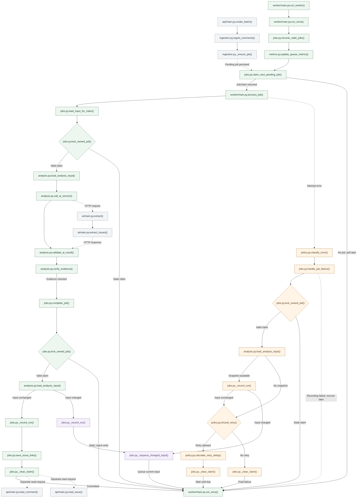
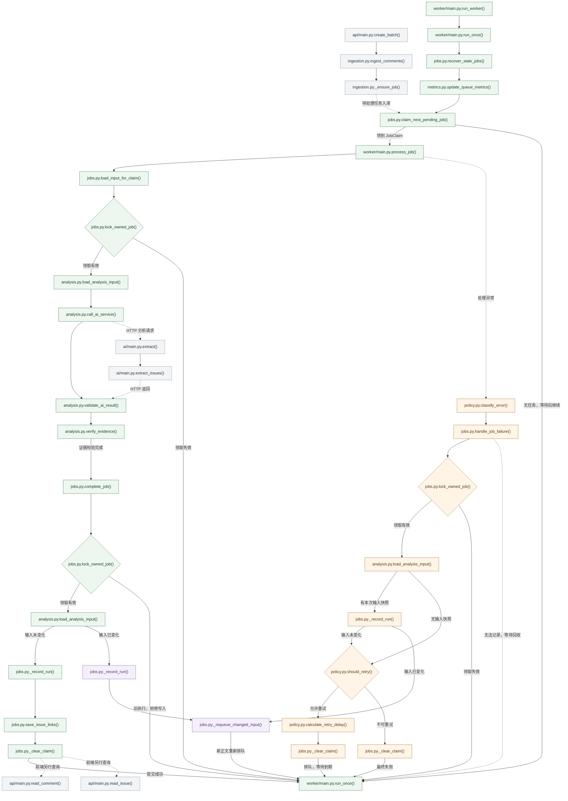

# R2 Function Flow / R2 函数流程图

## English

Nodes contain file/function names; conditions are written on the edges. Green shows normal
processing, orange retry/failure, purple changed input, and grey adjacent services/queries.
Arrows describe processing order, including HTTP and separate reads, rather than only direct
Python calls. Repeated names mark different call sites. The final `run_once()` means the next poll.
Recovery decisions stay inside `recover_stale_jobs()`; grouping and human-decision protection
stay inside `save_issue_links()`. Current grouping is category-based. The original product UI
is not connected; the midterm demo reads persisted results separately.

[English Mermaid source](r2-flowchart.en.mmd). The saved
[zoomable view](r2-flowchart.html) and [SVG](r2-flowchart.svg) retain the original Chinese labels.

## 中文

[打开可缩放流程图](r2-flowchart.html) · [SVG 矢量图](r2-flowchart.svg)

节点中只显示“代码文件 + 函数名”，条件和状态变化放在连线上。

- 绿色：R2 正常处理；橙色：失败与重试；紫色：正文变化；灰色：R1、R3 和查询接口。
- 箭头表示运行链路，不表示每条边都是直接的 Python 调用。HTTP、查询与回到外层循环均已在边上注明。
- 同名函数在不同位置重复出现，表示不同调用时点，不是多份实现。
- 为便于看清业务主线，省略了配置、日志、数据库会话等基础代码，以及只转发调用的两个 main 包装函数。
- 任务过期与次数用尽的回收决策位于 jobs.py.recover_stale_jobs() 内部；分组锁、旧建议失效标记和人工结论保护位于 jobs.py.save_issue_links() 内部。
- 类别归组仍为当前基线；图中不表示已经完成语义归组或原项目的前端接入。

最下方的 `worker/main.py.run_once()` 表示回到下一轮，省略跨越全图的回线。

