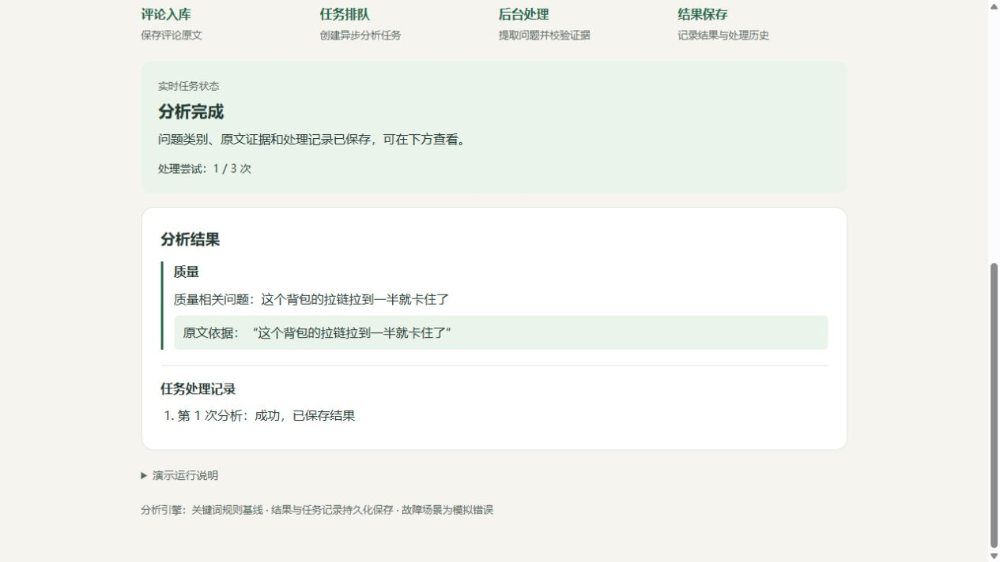

# Verification Record / 验证记录

## English

### Scope and date

Recorded on 29 October 2026 for the review-processing backend and midterm demo.
The tables distinguish the earlier complete checks from later English delivery-rule regressions.

### Recorded results

| Run | Observed result | Conditions |
| --- | --- | --- |
| Earlier complete R2 run | 94 unit/integration passed, including six PostgreSQL cases | Python 3.11.16 and PostgreSQL 16 in isolated Docker resources |
| R2 real-service smoke | Five passed; graceful Worker shutdown passed | API, actual rule AI, Worker and a test fault proxy |
| Database migrations | Upgrade → downgrade to `20260713_0001` → upgrade passed | Disposable PostgreSQL test database |
| R2 statement coverage | 92% | Unit/integration process only; service subprocesses excluded |
| Standalone bilingual demo acceptance | Ten cases passed (five in each language) | Rebuilt demo image, real HTTP calls, rule version and database assertions |
| Earlier restart persistence | Five jobs and eight analysis runs remained | Earlier isolated five-case demo run; not the count of the latest bilingual run |
| Chinese browser round | Submit → start → saved category/evidence/history observed | Repository-built demo at local port 18717 |
| English interface and analysis | Buttons confirmed by the developer; English HTTP/database cases checked | Interface interaction and analysis-service checks are recorded separately |

The demo repeats issue, no issue, unknown, fail-once success and continuous failure in both languages.
The earlier full-suite run included 36 additional English rule tests covering categories, negation, case, mixed text
and verbatim sentence evidence. Current analysis records identify `rule-baseline-2`.
The assertions cover stored pending/completed/failed states, evidence, attempt counts, analysis runs,
metrics and retention after starting another round. Demo scenarios are separate from the R2 smoke
suite and do not measure extraction accuracy. Existing dependency deprecation warnings did not fail tests.

### Coverage limits reported during demo use

Warranty/after-sales complaints, including refusal to provide a warranty, were reported as missed.
The current rules have no dedicated coverage for this topic. Depending on wording and language,
an unsupported complaint can return `no` or `unknown`. This is a known analysis limitation;
it does not invalidate successful job execution or demonstrate that the review is problem-free.
Verbatim evidence checks do not verify the interpretation. No general precision/recall result is claimed.

After the original full-suite run, the delivery-rule extension passed 78 analysis unit tests
(including existing Chinese/English tests) and four live demo regressions. These are separate checks,
not a new run of the complete unit/integration suite. Passing them does not cover warranty complaints.

### Reproduction

Full R2 checks on Windows with Docker:

```powershell
.\scripts\test_r2.ps1
```

For a running, idle demo:

```powershell
.\scripts\start_midterm_demo.ps1 -Action check
```

macOS/Linux demo check:

```bash
docker compose -f compose.midterm.yaml exec midterm-demo python demo/midterm/check_demo.py
```

Ordinary `pytest` does not enable the six PostgreSQL tests without `WORKER_TEST_DATABASE_URL`.
The full R2 script supplies an isolated `_test` database and starts the real-service checks.
Commands assume the repository root. See [Operations](../../../../docs/operations.md).

### Saved-result screenshot



The screenshot shows a completed first attempt, category “Quality”, a quotation from the submitted
Chinese zipper review, and a successful analysis record. It was captured through the Chinese interface.
The English page gives the sample's meaning: “The zipper on this backpack gets stuck halfway.”

No LLM extraction, semantic-grouping or real-platform quality scores are reported.

## 中文

### 范围与日期

本记录汇总 2026 年 10 月 29 日评论处理后台和期中 Demo 的验证结果。
较早的完整检查与后续英文物流规则回归分开记录。

### 已记录结果

| 检查 | 观察结果 | 条件 |
| --- | --- | --- |
| 较早完整 R2 检查 | 94 项单元／集成通过，含六项 PostgreSQL | 隔离 Docker 资源中的 Python 3.11.16、PostgreSQL 16 |
| R2 真实服务冒烟 | 五项通过，Worker 正常退出通过 | API、真实规则 AI、Worker 和测试故障代理 |
| 数据库迁移 | 升级 → 降至 `20260713_0001` → 再升级通过 | 可丢弃的 PostgreSQL 测试库 |
| R2 语句覆盖率 | 92% | 仅单元／集成进程，不含服务子进程 |
| 独立双语 Demo 验收 | 中英文各五例，共十例通过 | 重建 Demo 镜像、真实 HTTP、规则版本及数据库断言 |
| 较早的重启保留检查 | 五个任务、八条分析仍在 | 先前隔离的五例演示，不是本次双语检查的总数 |
| 中文浏览器演示 | 提交 → 启动 → 类别／证据／历史保存并展示 | 从仓库构建，使用本地 18717 端口 |
| 英文界面及分析 | 开发者确认按钮可用，英文 HTTP／数据库用例已检查 | 界面交互与分析服务检查分开记录 |

Demo 在中英文中分别检查有问题、无问题、无法判断、首次失败后成功和持续失败。
较早完整测试包含新增的 36 项英文规则测试，覆盖类别、否定、大小写、混合文本和逐字句子证据。
当前分析记录标识为 `rule-baseline-2`。
检查包含数据库中的等待／完成／失败状态、证据、次数、分析记录、指标以及新一轮后记录保留。
它与 R2 冒烟是不同测试，不衡量提取准确率。已有依赖弃用警告未造成测试失败。

### Demo 使用中反馈的覆盖边界

已收到拒绝保修等售后投诉漏检的反馈，当前规则没有专门覆盖该主题。
未覆盖投诉因说法和语言不同，可能返回 `no` 或 `unknown`。这是已知分析限制，
不等于任务没有成功执行，也不能据此证明评论没有问题。原文证据检查不验证理解，
当前没有报告面向任意评论的精确率或召回率。

在原完整测试之后，物流规则扩展另通过 78 项分析单元测试（含已有中英文测试）和四例真实 Demo 回归。
这是单独检查，不是重新运行了全部单元／集成测试；通过这些用例不代表覆盖了保修投诉。

### 复现

Windows 启动 Docker 后执行完整 R2 检查：

```powershell
.\scripts\test_r2.ps1
```

已启动且空闲的 Demo：

```powershell
.\scripts\start_midterm_demo.ps1 -Action check
```

macOS/Linux 的 Demo 检查：

```bash
docker compose -f compose.midterm.yaml exec midterm-demo python demo/midterm/check_demo.py
```

普通 `pytest` 未配置 `WORKER_TEST_DATABASE_URL` 时不会运行六项 PostgreSQL 测试。
完整 R2 脚本提供隔离的 `_test` 库并启动真实服务检查。命令在仓库根目录执行，见
[运行说明](../../../../docs/operations.md)。

### 结果截图


截图显示第一次分析完成、质量类别、所提交中文拉链评论的原文引用及成功分析记录，
由中文版界面获取。英文页提供示例释义：“The zipper on this backpack gets stuck halfway.”

当前没有大模型提取、语义归组或真实平台数据的质量分数。
